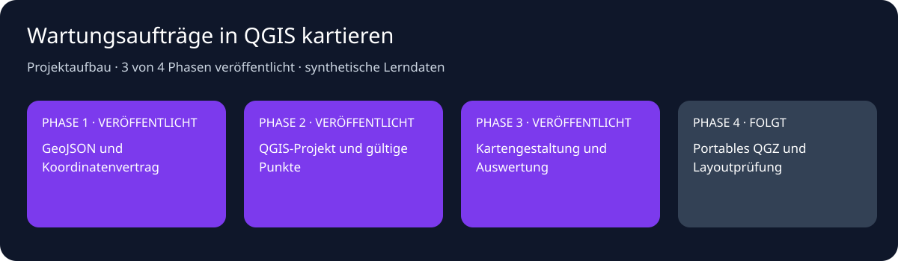

# Wartungsaufträge in QGIS kartieren

Wartungsaufträge einer fiktiven Gemeinde sollen nach Bezirk verortet werden; ungültige Koordinaten dürfen die Karte nicht verfälschen.



**Veröffentlichungsstand: Phase 3/4.** Dieses eigenständige Repository übernimmt zunächst den bereits lokal committeten Stand. Weitere fachliche Phasen werden im Abstand von mindestens vier Stunden veröffentlicht. Die technische Entwicklung und die öffentliche Veröffentlichung haben unterschiedliche echte Zeitpunkte.

## Was hier zu sehen ist

| Schritt | Inhalt | Hier veröffentlicht |
|---|---|---|
| 1 | GeoJSON und Koordinatenvertrag | Ja |
| 2 | QGIS-Projekt und gültige Punkte | Ja |
| 3 | Kartengestaltung und Auswertung | Ja |
| 4 | Portables QGZ und Layoutprüfung | Folgt |

## Fachlicher Nutzen

Geodatenqualität, EPSG:4326, Kartenaufbereitung und portable GIS-Projekte.

## Lokal starten

Im geklonten Repository ausführen; die benötigte Laufzeit muss installiert sein. Python-Beispiele verwenden 3.12, Node-Beispiele 24 und C# die im Projekt angegebene .NET-Version. Befehle mit uv laden die dort genau bezeichneten Pakete bei Bedarf.

```powershell
python -X utf8 nachweise/p11-t01_pruefen.py
```

Ausführliche technische Befehle: [START.md](START.md). [Öffentlicher Prüfstand](ABNAHME.json) und [Quellphasen](VERLAUF.json) dokumentieren Herkunft und echte Ausführungsdaten. Eine neue Repositorykopie ist kein neuer nativer Desktoplauf.

## Ergebnis des lokal geprüften Schlussstands

11 gültige Punkte; G12 mit Breite 95 ausgeschlossen. Gespeichertes QGIS-Projekt und Layout tatsächlich gelesen.

**Dieser Schlussstand ist lokal bereits geprüft, aber noch nicht vollständig in diesem Repository veröffentlicht.** Maßgeblich für den hier verfügbaren Code ist die Phasentabelle oben.

## Grenzen

Nur synthetische Geodaten; keine kommunale Berufserfahrung.

Eigenes kleines Lernprojekt mit synthetischen Daten, mit KI-Unterstützung entwickelt und geprüft. Keine Aussage über Berufserfahrung, menschliche Arbeitsstunden oder praktische Verwendung weiterer nur geplanter Produkte.
